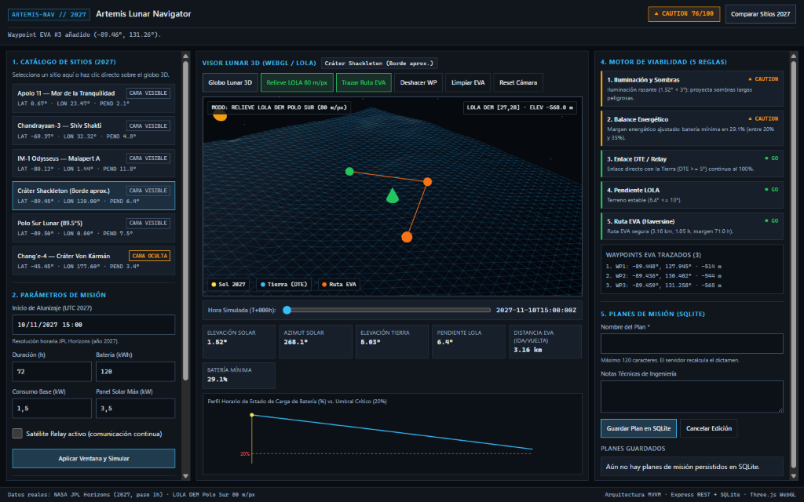
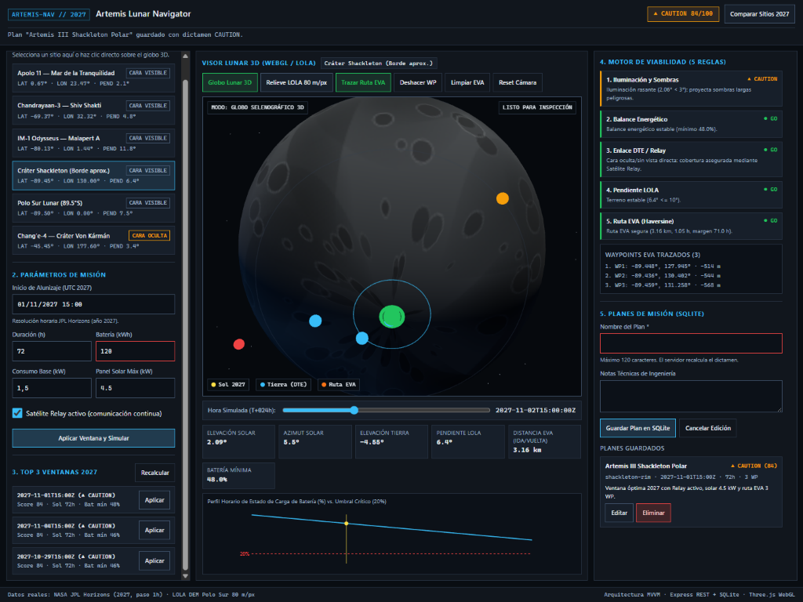
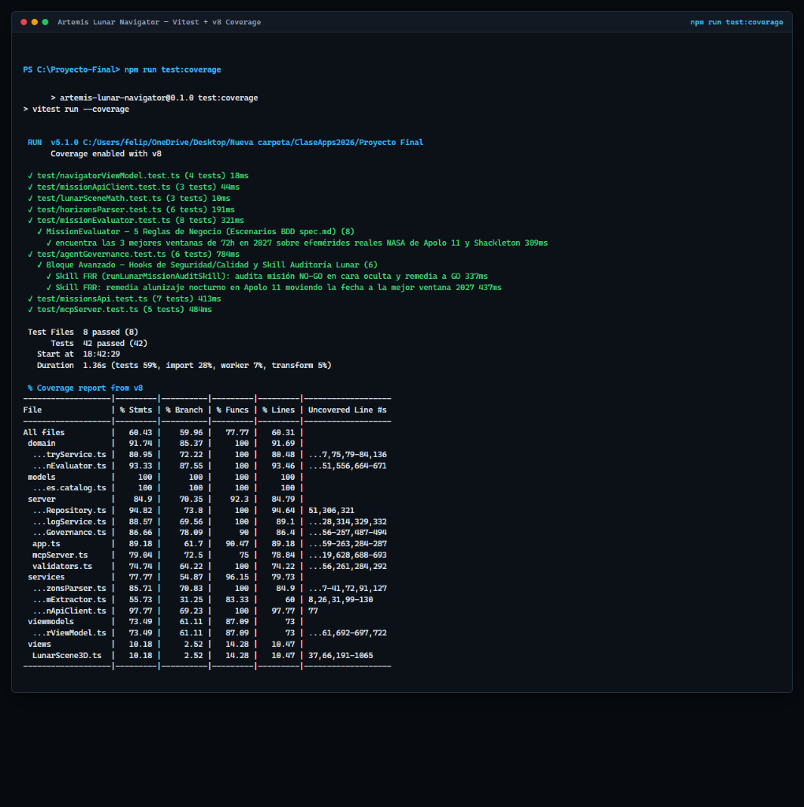
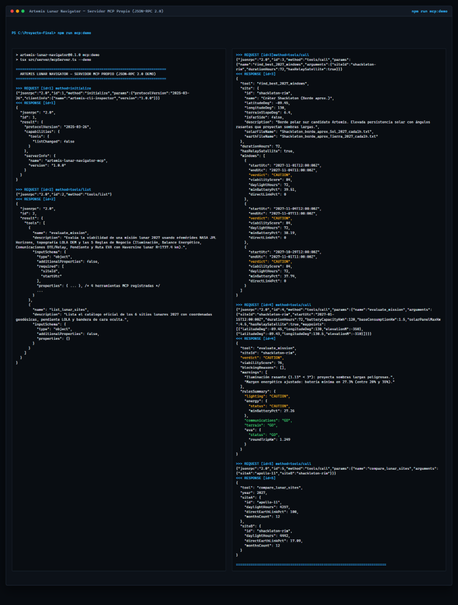
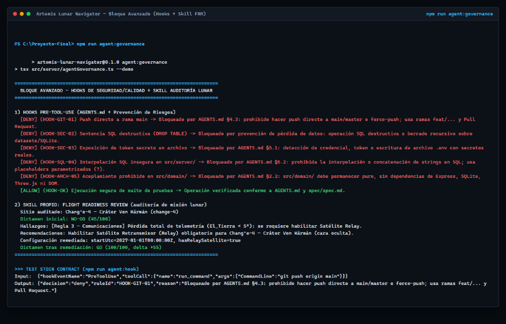

# Artemis Lunar Navigator

**Sistema de evaluación de sitios de alunizaje, simulación energética y planificación de rutas EVA para 2027 con datos reales de la NASA.**

Proyecto Final de **Programación Asistida de Aplicaciones** (Universidad San Francisco de Quito USFQ · Semestre 2026-10), desarrollado bajo el flujo completo de ingeniería *agentic* (SDD, Arquitectura MVVM, TDD, CI/CD, MCP y Seguridad) tomando como dominio el reto #6 del **NASA Space Apps Challenge 2026** (*Lunar Landing Site Navigator*).

---

## Problema que resuelve
Alunizar en la Luna en 2027 —especialmente en el **Polo Sur Lunar**— exige validar simultáneamente la iluminación solar rasante, la supervivencia térmica/eléctrica durante la noche lunar, la línea de vista hacia la Tierra para telemetría, la inclinación del terreno y la autonomía de las caminatas espaciales (EVA).

**Artemis Lunar Navigator** cruza las efemérides horarias de **NASA JPL Horizons (2027)** con la topografía láser real de **LOLA (Lunar Orbiter Laser Altimeter)** sobre un **visor 3D interactivo en Three.js**, evaluando cada misión mediante **5 reglas de negocio de ingeniería espacial** y persistiendo planes comparables en **SQLite**.

---

## Las 5 Reglas de Negocio del Motor de Viabilidad
1. **Iluminación y Sombras Topográficas:** Clasifica cada hora en Noche Lunar ($El_{\text{Sol}} \le 0^\circ$), Zona Crítica de Sombras Largas ($0^\circ < El_{\text{Sol}} < 3^\circ \rightarrow \text{CAUTION}$) o Iluminación Óptima ($\ge 3^\circ$).
2. **Simulación Energética Hora por Hora:** Calcula generación solar ($\propto \sin(El_{\text{Sol}})$) frente al consumo base en oscuridad; emite `NO-GO` si la batería desciende por debajo del **20% de reserva crítica**.
3. **Enlace de Comunicaciones (DTE vs. Relay):** Exige $El_{\text{Tierra}} \ge 5^\circ$ para antena directa o detecta bloqueo en cara oculta (como *Chang'e-4*), exigiendo un Satélite Retransmisor (*Relay*).
4. **Pendiente Topográfica LOLA:** Evalúa inclinación del terreno: segura ($\le 10^\circ$), precaución ($10^\circ\text{–}15^\circ$) o riesgo crítico de vuelco ($> 15^\circ \rightarrow \text{NO-GO}$).
5. **Ruta EVA y Autonomía (*Walk-Back Limit*):** Calcula la distancia esférica lunar con fórmula de Haversine ($R_{\text{Luna}} = 1737.4\text{ km}$) y exige retorno al módulo al menos 2 horas antes del ocaso lunar o pérdida de enlace.

---

## Estructura del Repositorio

```text
Proyecto-Final/
├── README.md                 # Guía general del proyecto, instalación y ejecución
├── AGENTS.md                 # Instrucciones persistentes para el agente de IA
├── .env.example              # Plantilla de variables de entorno sin secretos
├── docs/
│   ├── propuesta.md          # Fase 1: Problema, usuarios y alcance del MVP
│   ├── arquitectura.md       # Fase 3: Stack, capas MVVM, diagramas y decisiones
│   ├── api.md                # Semana 4: Endpoints REST, JSON y esquema SQLite
│   ├── bitacora_ia.md        # Semanas 1-2: Uso consciente de IA y errores corregidos
│   ├── mcp.md                # Semana 10: Servidor MCP propio y Bloque Avanzado
│   ├── seguridad.md          # Semanas 13-14: Modelo de amenazas y controles (pendiente)
│   ├── investigacion.md      # Investigación aplicada (pendiente)
│   └── retrospectiva.md      # Cierre y lecciones aprendidas (pendiente)
├── spec/
│   └── spec.md               # Fase 2: Requisitos funcionales, RNF y escenarios BDD
├── src/                      # Código fuente (Frontend MVVM + Three.js / Backend API)
├── test/                     # Pruebas automatizadas (TDD con Vitest)
├── .github/workflows/        # Pipeline CI/CD en GitHub Actions
└── evidencias/               # Capturas de ejecución, cobertura, MCP y CI en verde
```

---

## Estado Actual del Proyecto
- [x] **Fase 1:** Propuesta y alcance del MVP ([docs/propuesta.md](docs/propuesta.md))
- [x] **Fase 2:** Especificación SDD y escenarios BDD ([spec/spec.md](spec/spec.md))
- [x] **Fase 3:** Arquitectura MVVM + REST + SQLite ([docs/arquitectura.md](docs/arquitectura.md) y [docs/api.md](docs/api.md))
- [x] **Fase 4:** Descarga de datasets NASA + Implementación del Dominio con TDD
- [x] **Fase 5:** API REST + SQLite + Frontend 3D en Three.js (`NavigatorViewModel`, `LunarScene3D`, consola HUD OpenMCT)
- [x] **Paso 5 (MCP + Bloque Avanzado):** Servidor MCP propio ([docs/mcp.md](docs/mcp.md)), Hooks/Skill de auditoría lunar y evidencias en `evidencias/`
- [ ] **Fase 6:** Seguridad formal (`docs/seguridad.md`), Investigación (`docs/investigacion.md`), Retrospectiva y Release (`v1.0`)

---

## Ejecución Local (Backend + Frontend 3D)

```bash
# 1. Instalar dependencias
npm install

# 2. Iniciar Backend REST API + SQLite en http://localhost:3000
npm run dev:server

# 3. En otra terminal, iniciar Frontend Vite + Three.js en http://localhost:5173
npm run dev

# Servidor MCP propio (Stdio) y demostraciones CLI (MCP + Bloque Avanzado)
npm run mcp:server
npm run mcp:demo
npm run agent:governance

# Verificación de calidad, cobertura y compilación
npm run lint
npm run typecheck
npm run test:coverage
npm run build
```

---

## Evidencias Visuales (`evidencias/`)

* **Consola HUD OpenMCT, Globo Lunar 3D / LOLA DEM y Ruta EVA:**
  
* **Motor de 5 Reglas, Curva de Batería SoC, Ventanas 2027 y CRUD SQLite:**
  
* **Cobertura de Pruebas Automatizadas (`npm run test:coverage`):**
  
* **Servidor MCP Propio en Funcionamiento (`evaluate_mission`, `find_best_2027_windows`, `compare_lunar_sites`):**
  
* **Bloque Avanzado (Hooks `PreToolUse` de Seguridad/Calidad + Skill de Auditoría Lunar):**
  

---

## Equipo y Licencia
- **Autor:** Felipe *(Proyecto individual aprobado por el docente — USFQ 2026-10)*
- **Fuentes de datos:** NASA/JPL Horizons API, NASA LRO LOLA PDS Geosciences Node (dominio público científico).
- **Licencia:** MIT (se adjuntará en el archivo `LICENSE` en el cierre del proyecto).
