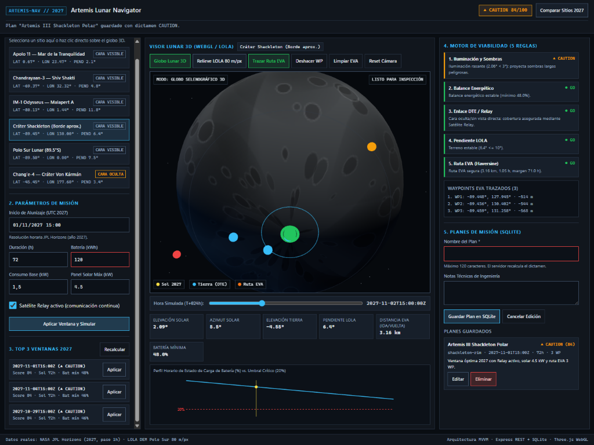

# Documentación de API REST y Esquema de Datos (`docs/api.md`)

Este documento especifica el contrato de comunicación entre el Frontend MVVM y el Backend REST + SQLite de **Artemis Lunar Navigator** (Semana 4).

* **URL base local:** `http://localhost:3000/api`
* **Formato de intercambio:** `application/json; charset=utf-8`

---

## 1. Catálogo y Telemetría de Sitios Lunares

### `GET /api/sites`
Retorna la lista de los 6 sitios lunares oficiales con sus coordenadas geodésicas y pendiente topográfica estimada (LOLA).

**Respuesta `200 OK`:**
```json
{
  "sites": [
    {
      "id": "shackleton-rim",
      "name": "Cráter Shackleton (Borde)",
      "latitudeDeg": -89.45,
      "longitudeDeg": 130.0,
      "terrainSlopeDeg": 6.4,
      "isFarSide": false,
      "description": "Borde sur polar con altos picos de iluminación solar en 2027."
    }
  ]
}
```

### `GET /api/sites/:id/telemetry?start=2027-01-01T00:00Z&hours=168`
Retorna las efemérides horarias (Sol y Tierra) parseadas de NASA JPL Horizons para el rango solicitado en 2027.
* **Errores:** `404` si `:id` no existe; `400` si `hours` no está entre `1` y `720` o la fecha es inválida.

### `GET /api/sites/:id/best-windows?durationHours=72&hasRelaySatellite=false`
Ejecuta el algoritmo de ventana deslizante sobre las 8,760 horas de 2027 y devuelve las 3 mejores fechas de alunizaje para ese sitio.

---

## 2. Evaluación de Viabilidad (Motor de 5 Reglas)

### `POST /api/missions/evaluate`
Evalúa sin persistir una configuración de misión completa contra las 5 reglas de negocio.

**Payload de entrada (`JSON`):**
```json
{
  "siteId": "shackleton-rim",
  "startUtc": "2027-06-15T12:00Z",
  "durationHours": 72,
  "batteryCapacityKwh": 120,
  "baseConsumptionKw": 1.8,
  "solarPanelMaxKw": 3.5,
  "hasRelaySatellite": true,
  "waypoints": [
    { "latitudeDeg": -89.45, "longitudeDeg": 130.0, "elevationM": 1950 },
    { "latitudeDeg": -89.42, "longitudeDeg": 131.2, "elevationM": 1920 }
  ]
}
```

**Respuesta `200 OK`:**
```json
{
  "verdict": "CAUTION",
  "viabilityScore": 84,
  "rules": {
    "lighting": { "status": "CAUTION", "minSolarElevationDeg": 1.2, "reason": "Sombras largas rasantes (< 3°)" },
    "energy": { "status": "GO", "minBatteryPct": 68.5, "blackoutHours": 4 },
    "communications": { "status": "GO", "directLinkPct": 41.6, "relayActive": true },
    "terrain": { "status": "GO", "slopeDeg": 6.4 },
    "eva": { "status": "GO", "roundTripKm": 2.42, "estimatedHours": 0.81 }
  }
}
```

---

## 3. CRUD Persistente de Planes de Misión (`SQLite`)

### `GET /api/missions`
Lista todos los planes de misión guardados ordenados por fecha de actualización descendente.

### `GET /api/missions/:id`
Obtiene el detalle completo de un plan guardado, incluyendo su lista ordenada de `waypoints` y su trazado horario.

### `POST /api/missions`
Valida entradas, ejecuta el motor del Dominio en el servidor para garantizar integridad de `verdict` y `viabilityScore`, y guarda el nuevo plan en SQLite.
* **Respuesta `201 Created`:** Objeto `MissionPlan` creado con su `id` (UUID).
* **Error `400 Bad Request`:** Si faltan campos, hay coordenadas fuera de rango (`lat ∉ [-90, 90]`, `lon ∉ [-180, 180]`) o textos exceden longitud máxima.

### `PUT /api/missions/:id`
Actualiza los parámetros o notas de un plan existente, recalcula automáticamente las 5 reglas de negocio y actualiza las tablas `missions` y `eva_waypoints` dentro de una transacción SQLite.
* **Respuesta `200 OK`:** Plan actualizado con nuevo dictamen.
* **Error `404 Not Found`:** Si el `id` no existe.

### `DELETE /api/missions/:id`
Elimina un plan de misión y sus *waypoints* asociados por clave foránea `ON DELETE CASCADE`.
* **Respuesta `200 OK`:** `{ "deleted": true, "id": "..." }`.

---

## 4. Endpoint JSON-RPC 2.0 para Servidor MCP (`POST /api/mcp`)

Además del transporte local por `stdio` (`npm run mcp:server`), el backend expone el servidor MCP del proyecto mediante HTTP JSON-RPC 2.0:

* **`POST /api/mcp`**: Acepta solicitudes JSON-RPC 2.0 (`initialize`, `ping`, `tools/list`, `tools/call`) para las herramientas `evaluate_mission`, `find_best_2027_windows`, `compare_lunar_sites` y `list_lunar_sites`.
* **Respuestas:** `200 OK` con el payload `JsonRpcResponse` (o `204 No Content` para notificaciones como `notifications/initialized`). Detalle completo en [`docs/mcp.md`](mcp.md).

---

## 5. Controles de Seguridad en la API
1. **Validación de esquemas:** Todas las peticiones `POST` y `PUT` validan tipos, rangos físicos y longitud máxima de cadenas antes de llegar al controlador.
2. **Consultas parametrizadas:** `better-sqlite3` utiliza únicamente placeholders `?` (0 concatenación de SQL).
3. **CORS restringido:** Limitado al origen configurado en `.env` (`CORS_ORIGIN`).
4. **Manejo seguro de errores:** El servidor nunca retorna stack traces ni detalles internos de SQLite al cliente en producción.

---

## 6. Evidencia de Simulador y CRUD en SQLite


