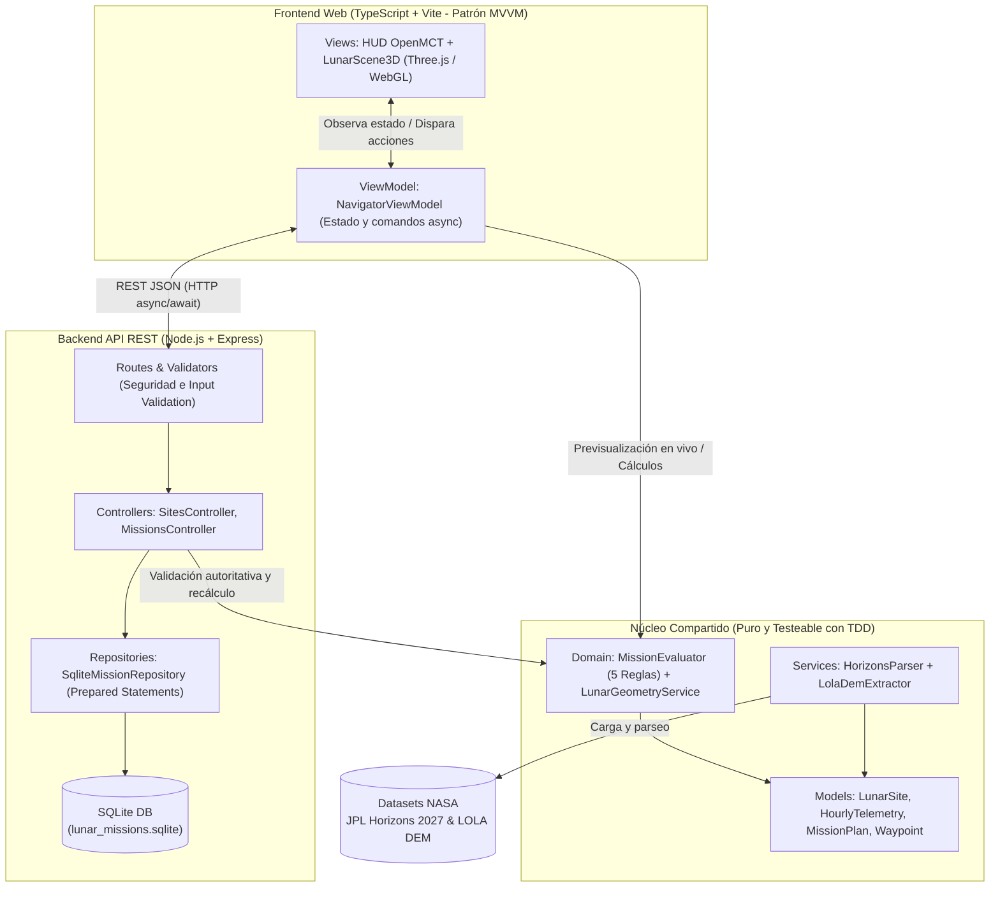
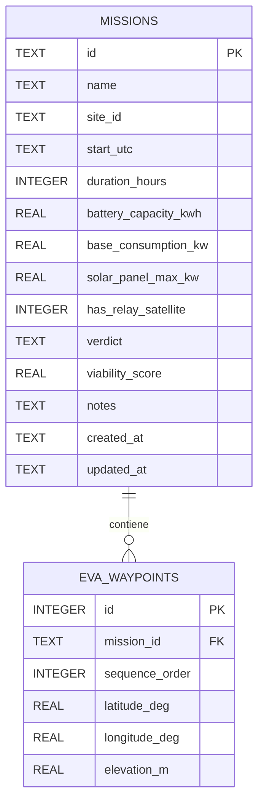

# Arquitectura del Sistema (`docs/arquitectura.md`)

Este documento detalla las decisiones tecnológicas, el patrón arquitectónico por capas y el diseño de datos de **Artemis Lunar Navigator**, cumpliendo los requisitos de las Semanas 4, 5 y 6.

---

## 1. Elección y Justificación del Stack Tecnológico

Aunque el curso recomienda Flutter para aplicaciones móviles/escritorio multiplataforma, la guía del proyecto permite elegir otro stack siempre que se justifique técnicamente y sea verificable mediante pruebas automatizadas.

| Capa / Necesidad | Tecnología Elegida | Justificación Técnica frente a Alternativas |
| :--- | :--- | :--- |
| **Motor 3D y Visualización** | **Three.js (WebGL)** | El propio enunciado de NASA Space Apps (#6) sugiere **Three.js** para volar sobre cráteres del Polo Sur Lunar. Flutter carece de soporte nativo maduro para mallas 3D WebGL con iluminación direccional solar en tiempo real y picking 3D (`Raycaster`) sin incrustar un WebView externo. |
| **Frontend (UI + Estado)** | **TypeScript + Vite + CSS Moderno** | Tipado estático estricto equivalente a Dart/Java, compilación instantánea en CI/CD y compatibilidad directa con los estándares de *Google Chrome Modern Web Guidance* (HTML semántico, `<dialog>`, variables CSS nativas). |
| **Backend y Persistencia** | **Node.js + Express + SQLite (`better-sqlite3`)** | Implementa una separación Cliente-Servidor real con API REST documentada y base de datos relacional embebida sin costo de infraestructura ni cuentas en la nube. Además, el backend actúa como proxy seguro hacia las APIs de la NASA. |
| **Pruebas y Calidad** | **Vitest + ESLint + tsc** | Ejecución completa de suite unitaria, de integración y análisis estático en segundos dentro de GitHub Actions. |

---

## 2. Separación en Capas y Patrón Arquitectónico (MVVM + Cliente-Servidor)

El sistema separa estrictamente la lógica matemática espacial de la interfaz gráfica 3D y de la persistencia en disco, aplicando los principios **SOLID** (especialmente Responsabilidad Única e Inversión de Dependencias):

1. **`Models` (`src/models/`):**
   * Interfaces y clases de datos inmutables (`LunarSite`, `HourlyTelemetry`, `Waypoint`, `EvaRoute`, `MissionEvaluation`, `MissionPlan`).
2. **`Domain` (`src/domain/`):**
   * **`MissionEvaluator`**: Ejecuta las 5 reglas de negocio (iluminación, batería hora por hora, comunicaciones DTE/Relay, pendiente topográfica y ruta EVA) y la búsqueda por ventana deslizante.
   * **`LunarGeometryService`**: Cálculos de distancia esférica Haversine con $R_{\text{Luna}} = 1737.4\text{ km}$ y derivación de pendiente sobre matrices DEM.
   * *Regla estricta:* Esta capa es **100% pura**; no importa `three`, `express`, `sqlite` ni `window/document`.
3. **`Services` (`src/services/`):**
   * **`HorizonsParser`**: Parsea archivos de efemérides NASA JPL Horizons (`$$SOE` ... `$$EOE`).
   * **`LolaDemExtractor`**: Lee la metadata PDS `.lbl` y extrae subregiones del archivo binario `.img` de LOLA.
   * **`MissionApiClient`**: Cliente HTTP asíncrono (`fetch`) usado por el ViewModel del Frontend.
4. **`ViewModels` (`src/viewmodels/`):**
   * **`NavigatorViewModel`**: Mantiene el estado reactivo de la sesión (sitio activo, hora seleccionada en 2027, waypoints marcados en 3D, resultado de evaluación y listado CRUD de misiones). Coordina las llamadas asíncronas sin manipular el DOM directamente.
5. **`Views` (`src/views/`):**
   * **`LunarScene3D`**: Encapsula la escena WebGL (esfera lunar texturizada, luz direccional solar calculada por azimut/elevación, malla de relieve polar LOLA y marcadores/rutas EVA por `Raycaster`).
   * **Paneles HUD**: Componentes web que renderizan la telemetría del `NavigatorViewModel`.
6. **`Server` (`src/server/`):**
   * **`routes` -> `controllers` -> `repositories`**: Expone la API REST, valida y sanitiza las entradas HTTP, invoca el `Domain` para evaluar/recalcular planes y persiste en SQLite mediante *prepared statements*.

---

## 3. Diagrama de Arquitectura por Capas

---

## 4. Diseño de Base de Datos (SQLite)

El esquema relacional mantiene en SQLite los planes de misión creados por el usuario junto con sus *waypoints* ordenados de ruta EVA (con eliminación en cascada):

---

## 5. Manejo de Asincronía y Decisiones Clave
* **Asincronía:** Todas las operaciones de I/O (carga de efemérides, peticiones al backend y lectura del terreno) utilizan `Promise` / `async-await` con estados explícitos de carga (`idle | loading | error | ready`) en el ViewModel, evitando bloqueos en el renderizado a 60 FPS de Three.js.
* **Cálculo Dual (Cliente + Servidor):** El Frontend puede previsualizar en tiempo real el movimiento del Sol y las rutas EVA sin latencia de red, pero el Backend **siempre vuelve a validar y recalcular** las 5 reglas en el Dominio antes de persistir un plan en SQLite, evitando manipulaciones desde el cliente.
