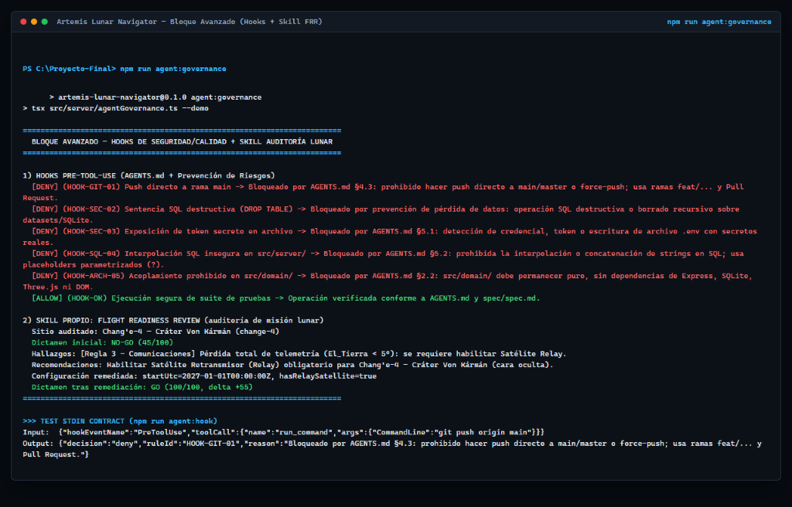

# Bitácora de Ingeniería Agentic (`docs/bitacora_ia.md`)

Registro transparente de herramientas de IA utilizadas, decisiones tomadas frente al agente, verificaciones manuales y errores detectados/corregidos (Semanas 1–2 y Sección 8 de la guía del proyecto).

---

## 1. Herramientas de IA Configuradas
* **Entorno principal:** Antigravity IDE con acceso controlado al workspace y lectura directa de los documentos base del curso.
* **Plugins / Skills activos:** `modern-web-guidance` (Google Chrome) para evitar patrones obsoletos de HTML/CSS/JS en la construcción del Frontend web.
* **Instrucciones persistentes:** Definidas en [`AGENTS.md`](../AGENTS.md) para forzar separación en capas MVVM, TDD, validación de seguridad y estética técnica no genérica.

---

## 2. Registro Cronológico de Decisiones y Verificaciones

### Sesión 1 — Análisis de Requisitos, Selección de Tema y Mitigación de Convergencia de IA
* **Qué se delegó al agente:**
  * Lectura íntegra y síntesis de los entregables obligatorios de `Proyecto_Final.pdf` y los 14 retos de `SpaceApps2026_Datos_y_Enlaces_de_Descarga.pdf`.
  * Análisis técnico comparativo entre Flutter y Web App Moderna (TypeScript + Three.js) para implementar un mapa lunar 3D con rutas.
  * Redacción inicial de `AGENTS.md`, `docs/propuesta.md`, `spec/spec.md`, `docs/arquitectura.md` y `docs/api.md` **antes** de escribir código fuente.
* **Decisiones humanas y criterio crítico aplicado:**
  1. **Control contra "proyectos clónicos por IA":** Al ser tema abierto entre compañeros, se identificó el riesgo de que múltiples proyectos generados por IA repitan las mismas 3 ideas literales del PDF y la misma estética genérica. Se decidió exigir:
     * Procesamiento real del archivo binario científico LOLA (`ldem_80s_80m.img`) en lugar de depender solo de los `.txt` simples.
     * Estética técnica inspirada en consolas espaciales (*NASA OpenMCT*) y prohibición explícita de plantillas genéricas en `AGENTS.md`.
     * Backend real con API REST + SQLite para el CRUD de misiones en lugar de almacenamiento efímero en memoria/navegador.
  2. **Profundización de Reglas de Negocio:** Se rechazó una regla trivial (`elevación > 0`) y se especificaron 5 reglas cuantitativas en `spec/spec.md` (sombras rasantes $<3^\circ$, balance horario con reserva crítica $<20\%$, comunicaciones DTE $\ge 5^\circ$ vs. Relay en cara oculta, límite de vuelco topográfico $>15^\circ$ y autonomía EVA con Haversine lunar).
  3. **Orden del ciclo de vida:** Se exigió construir y revisar primero la especificación (`spec/spec.md`) y la arquitectura (`docs/arquitectura.md`) antes de generar código de `src/`, respetando el criterio de trazabilidad SDD del curso.
  4. **Context Engineering preventivo (a iniciativa del estudiante):** Al notar que los dos PDFs base sumaban 44 páginas pesadas (con 13 retos de la NASA que no se usarán), el estudiante propuso destilar la rúbrica del curso y únicamente las fichas/URLs del Challenge #6 en un archivo Markdown ligero ([`docs/contexto_referencia.md`](contexto_referencia.md)) y archivar los PDFs en `_archivos_originales_profe/` (ignorado por Git y restringido en `AGENTS.md`). Esto reduce el consumo de tokens, mantiene foco limpio y evita alucinaciones en sesiones largas.

---

### Sesión 2 — Paso 3: Pipeline CI/CD en GitHub Actions y Backend REST API + SQLite
* **Qué se delegó al agente:**
  * Configuración del flujo de integración continua en [`.github/workflows/ci.yml`](../.github/workflows/ci.yml) (`lint`, `typecheck`, `test:coverage`, `build --if-present` y subida de artefactos con permisos mínimos `contents: read`).
  * Implementación del Backend REST en `src/server/` (`validators.ts`, `SqliteMissionRepository.ts`, `TelemetryCatalogService.ts`, `app.ts`, `index.ts`) y suite de integración con Supertest en [`test/missionsApi.test.ts`](../test/missionsApi.test.ts).
* **Decisiones humanas y verificaciones aplicadas:**
  1. **Trabajo por sesiones ligeras y ramas pequeñas:** Se dividió el Paso 3 en la entrega de `feat/domain-motor-reglas` (motor + parsers + CI) y la rama `feat/backend-api-sqlite` para mantener revisiones acotadas vía Pull Request hacia `main`.
  2. **Auditoría de dependencias (`AGENTS.md` §5.4):** Tras instalar `express`, `cors`, `better-sqlite3` y `supertest`, se verificó carga nativa de `better-sqlite3` en Node v24 y se ejecutó `npm audit --omit=dev` (0 vulnerabilidades en producción; las 12 alertas `high` en desarrollo corresponden únicamente a la cadena transitiva `picomatch` de herramientas de test/lint).
  3. **Recálculo autoritativo y seguridad SQL/XSS:** Se verificó que `POST /api/missions` y `PUT /api/missions/:id` validan rangos físicos, sanitizan etiquetas HTML/script sin corromper consultas parametrizadas (`?`) en SQLite y recalculan el dictamen desde `MissionEvaluator` dentro de transacciones atómicas.

---

### Sesión 3 — Paso 4: Frontend MVVM, Visor Lunar 3D (Three.js + LOLA DEM) y Consola HUD OpenMCT
* **Qué se delegó al agente:**
  * Cliente REST [`src/services/MissionApiClient.ts`](../src/services/MissionApiClient.ts), ViewModel reactivo [`src/viewmodels/NavigatorViewModel.ts`](../src/viewmodels/NavigatorViewModel.ts), escena 3D WebGL [`src/views/LunarScene3D.ts`](../src/views/LunarScene3D.ts), consola HUD [`src/views/HudConsoleView.ts`](../src/views/HudConsoleView.ts) y suites TDD en `test/`.
* **Decisiones humanas y verificaciones aplicadas:**
  1. **Aislamiento estricto MVVM:** Se verificó que `NavigatorViewModel` no importa `three` ni accede al DOM (`window`/`document`), ejecutando toda la reactividad y previsualización mediante `MissionEvaluator` e inyección de `NavigatorApiGateway`.
  2. **Modern Web Guidance (Google Chrome):** Se consultaron las guías `dialog`, `responsive-table`, `css-layout`, `accessibility`, `color`, `forms` y `html`, aplicando `<dialog closedby="any">` con fallback `getBoundingClientRect()`, tabla comparativa con `@container`, `color-mix(in oklab, ...)` en lugar de `oklch` con neutros, y construcción DOM por `textContent` sin `innerHTML` para prevenir XSS.
  3. **Auditoría de producción:** Tras instalar `three`, `@types/three` y `vite`, `npm audit --omit=dev` confirmó **0 vulnerabilidades** en producción.

---

### Sesión 4 — Paso 5: Servidor MCP Propio, Bloque Avanzado y Evidencias (`feat/mcp-and-advanced-block`)
* **Qué se delegó al agente:**
  * Implementación del servidor MCP propio [`src/server/mcpServer.ts`](../src/server/mcpServer.ts) (JSON-RPC 2.0 sobre Stdio y endpoint `POST /api/mcp` en [`src/server/app.ts`](../src/server/app.ts)), exponiendo `evaluate_mission`, `find_best_2027_windows`, `compare_lunar_sites` y `list_lunar_sites`.
  * Implementación del Bloque Avanzado en [`src/server/agentGovernance.ts`](../src/server/agentGovernance.ts): Hooks de seguridad/calidad `PreToolUse` (`HOOK-GIT-01`, `HOOK-SEC-02`, `HOOK-SEC-03`, `HOOK-SQL-04`, `HOOK-ARCH-05`) y Skill propio de auditoría *Flight Readiness Review (FRR)* (`runLunarMissionAuditSkill`).
  * Suites de pruebas automatizadas [`test/mcpServer.test.ts`](../test/mcpServer.test.ts) y [`test/agentGovernance.test.ts`](../test/agentGovernance.test.ts), además de [`docs/mcp.md`](mcp.md).
* **Decisiones humanas y verificaciones aplicadas:**
  1. **Servidor MCP sin dependencias externas vulnerables:** Se implementó el protocolo JSON-RPC 2.0 MCP (`2025-03-26`) reutilizando directamente `TelemetryCatalogService`, `validateMissionConfigInput` y `MissionEvaluator`, evitando paquetes externos innecesarios y preservando `0` vulnerabilidades en producción.
  2. **Restricción estricta del árbol oficial (`AGENTS.md` §1.1):** Se ubicaron tanto el servidor MCP como los módulos de gobernanza (Hooks y Skill) dentro de `src/server/` y sus pruebas en `test/`, sin crear carpetas fuera de la estructura oficial.
  3. **Verificación en vivo del Bloque Avanzado:** Se ejecutó `npm run agent:governance` y `npm run agent:hook`, comprobando el bloqueo de `git push origin main`, `DROP TABLE`, exposición de tokens, concatenación SQL y dependencias impuras en `src/domain/`, así como la remediación automática de *Chang'e-4* (`NO-GO 45/100` -> `GO 100/100`).

---

### Sesión 5 — Paso 6: Seguridad, Investigación, Retrospectiva y Cierre `v1.0` (`docs/security-research-and-v1-release`)
* **Qué se delegó al agente:**
  * Verificación por GitHub REST API de las reglas activas de protección de `main` y del workflow CI/CD del PR #4, generando las evidencias finales [`evidencias/01_main_protegida.png`](../evidencias/01_main_protegida.png) y [`evidencias/02_ci_workflow_y_pr_verde.png`](../evidencias/02_ci_workflow_y_pr_verde.png).
  * Redacción de [`docs/seguridad.md`](seguridad.md), [`docs/investigacion.md`](investigacion.md), [`docs/retrospectiva.md`](retrospectiva.md), [`LICENSE`](../LICENSE) y actualización final de [`README.md`](../README.md) y [`package.json`](../package.json) (`1.0.0`).
* **Decisiones humanas y verificaciones aplicadas:**
  1. **Veracidad estricta en evidencias y documentación:** Al detectar que `settings/branches` en GitHub exige sesión de administrador en el navegador, se evitó falsificar una captura de UI privada y se generó [`evidencias/01_main_protegida.png`](../evidencias/01_main_protegida.png) con la salida real verificada vía `gh api repos/Philipys/Proyecto-Final/branches/main/protection` junto al historial de PRs fusionados; para [`evidencias/02_ci_workflow_y_pr_verde.png`](../evidencias/02_ci_workflow_y_pr_verde.png) se capturó directamente la página pública de GitHub Actions del PR #4 mostrando el artefacto `build-and-coverage-report`.
  2. **Auditoría exacta de métricas y archivos:** Se verificó directamente `maxSlopeDeg: 16.75°` en `data/lola/south_pole_dem_sample.json`, `0` usos de `innerHTML` en `src/`, `0` secretos en el historial Git (`git ls-files`) y `0` vulnerabilidades en `npm audit --omit=dev` (aislando las 12 alertas `high` de `picomatch` en `devDependencies`).
  3. **Cierre y publicación:** Merge vía Pull Request final con CI en verde y publicación del Release `v1.0` con el artefacto web compilado (`dist/`).

---

## 3. Errores / Limitaciones del Agente Detectados y Corregidos
*(Nota: El curso exige documentar al menos **3 casos reales** a lo largo del proyecto donde el agente se equivocó, propuso algo inseguro/inviable o falló en el entorno. Este registro se irá ampliando en cada fase.)*

### Caso #1 — Intento de inicializar Git dentro de una carpeta padre que ya era un repositorio y bloqueo de permisos del sandbox
* **Qué ocurrió:** Al intentar inicializar el repositorio en `Proyecto Final` usando `git init -b main` seguido de `git remote add origin`, el comando `git init` falló silenciosamente en el primer paso por permisos del usuario de sandbox (`Phillip\CodexSandboxUsers`) sobre la carpeta en OneDrive. Al ejecutarse el segundo comando (`git remote add`), Git buscó hacia arriba en el árbol de directorios y detectó el repositorio padre `ClaseApps2026` (apuntando a otro remoto `ClaseApps2026.git`).
* **Cómo se detectó:** Revisando la salida real del comando (`Permission denied` + `git rev-parse --show-toplevel` apuntando a `ClaseApps2026` en lugar de `Proyecto Final`).
* **Corrección aplicada:** Se detuvo la ejecución inmediatamente, se evitó modificar el repositorio padre de la asignatura y se ajustó el plan para usar operaciones de escritura seguras (`write_file`) y aislar `git init` explícitamente dentro de `Proyecto Final`.

### Caso #2 — Error de unidades (`<m/pix>` vs. km) y `OFFSET` al decodificar el archivo científico LOLA DEM (`ldem_80s_80m.lbl`)
* **Qué ocurrió:** Al implementar la primera versión de `LolaDemExtractor.ts` sin haber leído el archivo `.lbl` descargado, el agente asumió que `MAP_SCALE` venía en kilómetros/píxel (`0.08`) y lo multiplicó por `1000`, además de sumar `OFFSET = 1737400` a la elevación. Como resultado, las elevaciones aparecían en `1,737,892 m` y la pendiente media calculada en el Polo Sur cayó falsamente a `0.02°` (dividiendo por 80 km en lugar de 80 m).
* **Cómo se detectó:** Inspeccionando los resultados reales impresos por el script (`min=1737892 m`, `pendiente media=0.02°`) y leyendo línea por línea la etiqueta oficial `data/lola/ldem_80s_80m.lbl`, donde la NASA documenta explícitamente `MAP_SCALE = 80 <m/pix>` y `HEIGHT = (DN * SCALING_FACTOR)` (mientras `OFFSET` convierte a radio planetario).
* **Corrección aplicada:** Se corrigió `parseLolaPdsLabel()` para leer la unidad real (`<m/pix>` vs. `<km/pix>`), se pasó `offset = 0` para alturas relativas al geoide lunar y se re-extrajo la grilla real `48x48` del Polo Sur, obteniendo valores físicos reales (`-766.5 m` a `-238.5 m` y pendiente media de `6.27°`).

### Caso #3 — Distorsión métrica polar (`6.4%`) por aproximación plana `cos(centerLat)` al proyectar waypoints sobre la malla LOLA DEM (`80 m/píxel`)
* **Qué ocurrió:** En la primera implementación de `lolaGridPointToWorld()` dentro de [`src/views/LunarScene3D.ts`](../src/views/LunarScene3D.ts), el agente aproximó el desplazamiento de longitud sobre la grilla polar sur dividiendo por `cos(centerLatDeg)` constante (a `-89.45°`, donde `cos(-89.45°) = 0.0096`) en lugar de resolver la geometría esférica real alrededor del Polo Sur. Al desplazar un punto `1.08 km` al norte de `-89.45°`, el radio del paralelo crece en `6.4%`, por lo que `10` píxeles horizontales (`800 m` reales en LOLA) se proyectaban a `0.8517 km` al medirlos con Haversine en la Regla 5 EVA.
* **Cómo se detectó:** Al ejecutar la prueba unitaria TDD [`test/lunarSceneMath.test.ts`](../test/lunarSceneMath.test.ts), que falló inmediatamente (`expected 0.851699... to be less than 0.85`).
* **Corrección aplicada:** Se reemplazó la aproximación plana tanto en `lolaGridPointToWorld()` como en su inversa `latLonToLolaWorld()` por la proyección esférica acimutal equidistante exacta con radio lunar $R_{\text{Luna}} = 1737.4\text{ km}$, eliminando el sesgo polar y manejando sin singularidad las coordenadas cercanas a `-90°`.
