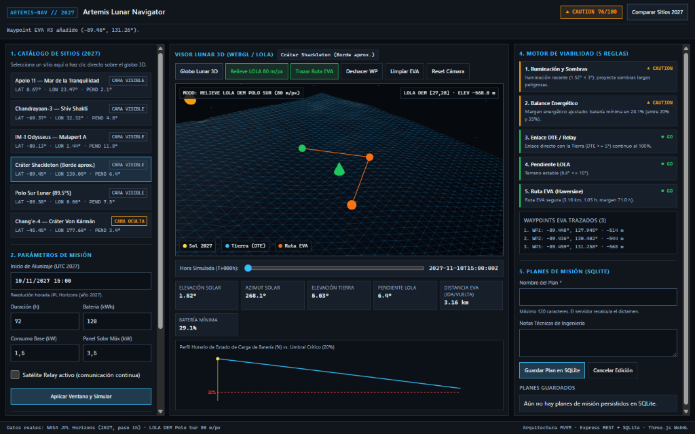
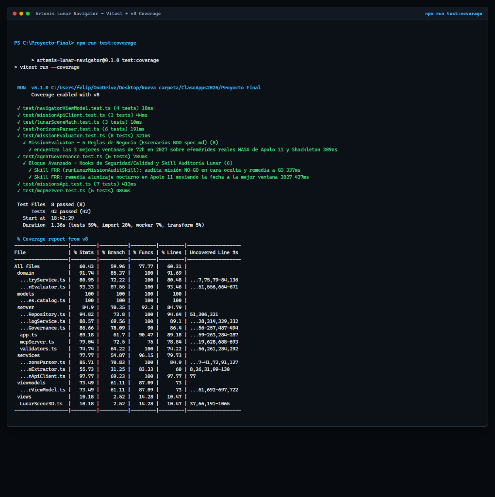

# Investigación Técnica Aplicada (`docs/investigacion.md`)

Documentación de la investigación aplicada fuera del temario base de clase (Sección A.4 de la rúbrica, 10 puntos): **procesamiento binario científico NASA PDS3 (LOLA DEM)**, **proyección esférica acimutal equidistante polar** y **visualización 3D interactiva en WebGL (Three.js) con iluminación astronómica topocéntrica**.

---

## 1. Qué se Investigó y Por Qué es Relevante

A diferencia de aplicaciones CRUD convencionales o prototipos 2D con datos simulados, el reto #6 de NASA Space Apps (*Lunar Landing Site Navigator*) exige evaluar sitios reales del Polo Sur Lunar —donde la iluminación solar es rasante ($<3^\circ$), las sombras se alargan kilómetros y la geometría polar colapsa proyecciones planas simples. Se investigaron tres áreas técnicas no cubiertas en clase:

1. **Formato binario científico NASA PDS3 (`LRO LOLA DEM` `ldem_80s_80m.img` + `.lbl`):**
   * El archivo oficial del *Lunar Orbiter Laser Altimeter* (`80°S–90°S`, `80 m/píxel`, ~110.2 MB) no es una imagen estándar PNG/GeoTIFF, sino un arreglo binario sin cabecera de `7600 × 7600` enteros de 16 bits con signo en orden *little-endian* (`SAMPLE_TYPE = LSB_INTEGER`, `SAMPLE_BITS = 16`).
   * Investigar la especificación PDS3 permitió extraer subventanas exactas vía peticiones **HTTP `Range`** (`206 Partial Content`) leyendo únicamente los bytes necesarios en lugar de descargar o cargar 110 MB completos en memoria, convertir cada *Digital Number* (`DN`) a altura física sobre la esfera de referencia lunar ($R_{\text{Luna}} = 1737.4\text{ km}$) mediante `HEIGHT = DN * SCALING_FACTOR` (distinguiendo `HEIGHT` frente a `PLANETARY_RADIUS = (DN * SCALING_FACTOR) + OFFSET`), y derivar la pendiente topográfica local mediante diferencias finitas centrales:
     $$\text{pendiente} = \arctan\left(\sqrt{\left(\frac{z_{\text{E}} - z_{\text{O}}}{2\Delta x}\right)^2 + \left(\frac{z_{\text{N}} - z_{\text{S}}}{2\Delta y}\right)^2}\right)$$
2. **Proyección esférica acimutal equidistante polar e inversa:**
   * Cerca del Polo Sur (`-89.45°` en el borde del cráter Shackleton), proyectar desplazamientos métricos $(\Delta x, \Delta y)$ de la grilla LOLA dividiendo por $\cos(\text{lat}_0)$ constante introduce errores rápidamente crecientes (medidos en `6.4%` a tan solo `1 km` del centro) y colapsa en la singularidad de los `-90°`.
   * Se investigaron las ecuaciones esféricas directa e inversa de la proyección **Acimutal Equidistante** sobre esfera de radio $R = 1737.4\text{ km}$, manteniendo consistencia métrica exacta entre los clics en la malla 3D (`x, z` en kilómetros) y la distancia geodésica Haversine de la Regla 5 (EVA).
3. **Motor WebGL en Three.js con marco topocéntrico ENU y `Raycaster`:**
   * Para alinear la iluminación 3D de Three.js con las efemérides reales de **NASA JPL Horizons** (`COMMAND='10'` Sol, `COMMAND='399'` Tierra, `QUANTITIES='4'` azimut y elevación topocéntrica), se investigó la transformación desde coordenadas horizontales locales $(\text{Az}, \text{El})$ en la base ortonormal local **Este–Norte–Arriba (`ENU`)** hacia el espacio cartesiano 3D `Y-up` del globo lunar y de la malla topográfica local, junto con `THREE.Raycaster` para seleccionar sitios y trazar waypoints EVA directamente sobre geometría desplazada por altura.

---

## 2. Fuentes Oficiales Citadas

1. **NASA PDS Geosciences Node — LRO LOLA Gridded Data Record (`LDEM_80S_80M`):**
   * Etiqueta oficial del producto (`LRO-L-LOLA-4-GDR-V1.0`, `V2.0`): [`ldem_80s_80m.lbl`](https://pds-geosciences.wustl.edu/lro/lro-l-lola-3-rdr-v1/lrolol_1xxx/data/lola_gdr/polar/img/ldem_80s_80m.lbl) y [`ldem_80s_80m.img`](https://pds-geosciences.wustl.edu/lro/lro-l-lola-3-rdr-v1/lrolol_1xxx/data/lola_gdr/polar/img/ldem_80s_80m.img).
   * Documentación científica del instrumento LOLA: Smith, D. E., et al. (2010), *The Lunar Orbiter Laser Altimeter Investigation on the Lunar Reconnaissance Orbiter Mission*, Space Science Reviews, 150, 209–241.
2. **NASA JPL Horizons System API:**
   * Especificación oficial de efemérides de observador topocéntrico lunar (`CENTER='coord@301'`, `COORD_TYPE='GEODETIC'`, `QUANTITIES='4'`): [`https://ssd-api.jpl.nasa.gov/doc/horizons.html`](https://ssd-api.jpl.nasa.gov/doc/horizons.html) y portal [`https://ssd.jpl.nasa.gov/horizons/`](https://ssd.jpl.nasa.gov/horizons/).
3. **Proyecciones Cartográficas Esféricas (Acimutal Equidistante):**
   * Snyder, J. P. (1987). *Map Projections — A Working Manual*. U.S. Geological Survey Professional Paper 1395 (Sección 25: Azimuthal Equidistant Projection, pp. 191–202).
4. **Three.js / WebGL & Google Chrome Modern Web Guidance:**
   * Documentación oficial de Three.js (`DirectionalLight`, `BufferGeometry`, `Raycaster`, `CanvasTexture`): [`https://threejs.org/docs/`](https://threejs.org/docs/).
   * Estándares HTML/CSS nativos (`<dialog>`, `@container`, `color-mix(in oklab, ...)`, accesibilidad ARIA) consultados mediante el skill `modern-web-guidance`.

---

## 3. Cómo Cambió el Código (Trazabilidad a Commits y PRs)

| Área Investigada | Implementación en el Código | Commit / PR |
| :--- | :--- | :--- |
| **Decodificación PDS3 binaria `int16` y pendiente por diferencias finitas** | `parseLolaPdsLabel()`, `decodeLolaInt16Samples()` (`DataView.getInt16(..., true)`), `buildLolaDemSample()` en [`src/services/LolaDemExtractor.ts`](../src/services/LolaDemExtractor.ts); `calculateSlopeDegFromGrid()` y `calculateHaversineLunarDistanceKm()` en [`src/domain/LunarGeometryService.ts`](../src/domain/LunarGeometryService.ts); extracción parcial vía HTTP `Range` en [`src/services/downloadNasaData.ts`](../src/services/downloadNasaData.ts). | Commit `6f5eb84` · [PR #1](https://github.com/Philipys/Proyecto-Final/pull/1) |
| **Barrido eficiente sobre 8,760 h anuales (JPL Horizons 2027)** | Optimización de `findBestLandingWindows()` en [`src/domain/MissionEvaluator.ts`](../src/domain/MissionEvaluator.ts) usando buffers tipados `Float64Array` / `Uint8Array` para evitar asignaciones de strings/objetos dentro de la ventana deslizante anual. | Commit `daf78ad` · [PR #2](https://github.com/Philipys/Proyecto-Final/pull/2) |
| **Visor Lunar 3D WebGL, marco ENU y proyección acimutal equidistante** | `latLonToLunarCartesian()`, `cartesianToLatLon()`, `azElToDirectionVector()`, `lolaGridPointToWorld()`, `latLonToLolaWorld()` y clase `LunarScene3D` (`THREE.DirectionalLight`, `THREE.Raycaster`, malla desplazada por LOLA DEM y trazado de waypoints EVA) en [`src/views/LunarScene3D.ts`](../src/views/LunarScene3D.ts), integrados con la consola HUD [`src/views/HudConsoleView.ts`](../src/views/HudConsoleView.ts). | Commit `c1eaf46` · [PR #3](https://github.com/Philipys/Proyecto-Final/pull/3) |

---

## 4. Resultados y Límites

### 4.1 Resultados Cuantitativos Observados
* **Topografía real LOLA extraída (`data/lola/south_pole_dem_sample.json`):** Subventana real `48 × 48` píxeles (`3.84 km × 3.84 km` a `80 m/px`, centrada en `line: 3620, sample: 3920`) con elevaciones entre **`-766.5 m`** y **`-238.5 m`**, pendiente media de **`6.27°`** y pendiente máxima local de **`16.75°`** (capturando crestas reales que superan el umbral crítico `> 15°` de la Regla 4).
* **Consistencia métrica polar:** La proyección acimutal equidistante entre celdas de malla 3D (`80 m/px`) y Haversine lunar ($R = 1737.4\text{ km}$) converge a **`0.80 km`** exactos para `10` columnas en `-89.45°` (verificado en [`test/lunarSceneMath.test.ts`](../test/lunarSceneMath.test.ts)), frente a `0.8517 km` de la aproximación plana previa.
* **Rendimiento del barrido anual 2027:** El análisis completo de 8,760 horas de efemérides con simulación horaria de batería y rutas EVA para Apolo 11 y Shackleton corre dentro de `test/missionEvaluator.test.ts` en **`248 ms`** totales.

### 4.2 Límites Conocidos y Qué se Haría Distinto en `v2.0`
1. **Subventana polar fija (`48 × 48`):** Para mantener ligero el repositorio y la carga instantánea del navegador sin un servidor de teselas binarias, se extrajo una subventana representativa de `3.84 km × 3.84 km` alrededor del Polo Sur/Shackleton en lugar de servir dinámicamente los `7600 × 7600` píxeles del `.img` completo (o los DEM LOLA PGDA de 5–20 m). En una `v2.0`, el backend expondría un servicio de *tiles* bajo demanda con caché LRU y decodificación en *Web Worker*.
2. **Modelo simplificado de oclusión de sombras:** La Regla 1 clasifica sombras largas mediante el umbral solar de ingeniería ($0^\circ < El_{\text{Sol}} < 3^\circ \rightarrow \text{CAUTION}$) y el visor 3D proyecta sombras con `DirectionalLight`, pero no calcula *horizon masking* geométrico contra montañas lejanas fuera de la subventana `48 × 48`. En una `v2.0` se añadirían mapas de horizonte precalculados (*horizon elevation masks* de 360°) por sitio.

---

## 5. Verificación y Errores del Agente Corregidos Gracias a las Pruebas

La investigación no quedó solo en teoría: las pruebas unitarias TDD expusieron **dos errores físicos reales** generados por el agente de IA que habrían pasado desapercibidos sin verificación numérica (detallados también en [`docs/bitacora_ia.md`](bitacora_ia.md)):

1. **Error de unidades PDS3 y `OFFSET` en `LolaDemExtractor.ts` (Caso #2 de la bitácora):**
   * *Fallo del agente:* Asumió sin leer `ldem_80s_80m.lbl` que `MAP_SCALE` estaba en kilómetros (`0.08`) y sumó `OFFSET = 1737400` a cada altura, produciendo elevaciones de `1,737,892 m` y pendientes irreales de `0.02°`.
   * *Corrección verificada:* Se actualizó `parseLolaPdsLabel()` (`readScaleMetersField`) para leer explícitamente la unidad `<m/pix>` (`80 m/px`), se fijó `offset = 0` siguiendo la fórmula oficial de la etiqueta `HEIGHT = (DN * SCALING_FACTOR)`, y se validó con aserciones reales en [`test/horizonsParser.test.ts`](../test/horizonsParser.test.ts).
2. **Sesgo métrico polar de `6.4%` en `LunarScene3D.ts` (Caso #3 de la bitácora):**
   * *Fallo del agente:* En `lolaGridPointToWorld()`, dividió el desplazamiento Este por `cos(centerLatDeg)` constante cerca de `-89.45°`, provocando que `10` píxeles (`800 m`) se mapearan a `0.8517 km` al medirlos con Haversine.
   * *Corrección verificada:* El fallo inmediato de [`test/lunarSceneMath.test.ts`](../test/lunarSceneMath.test.ts) (`expected 0.851699... to be less than 0.85`) llevó a sustituir la aproximación plana por la proyección esférica acimutal equidistante exacta en `lolaGridPointToWorld()` y `latLonToLolaWorld()`.

