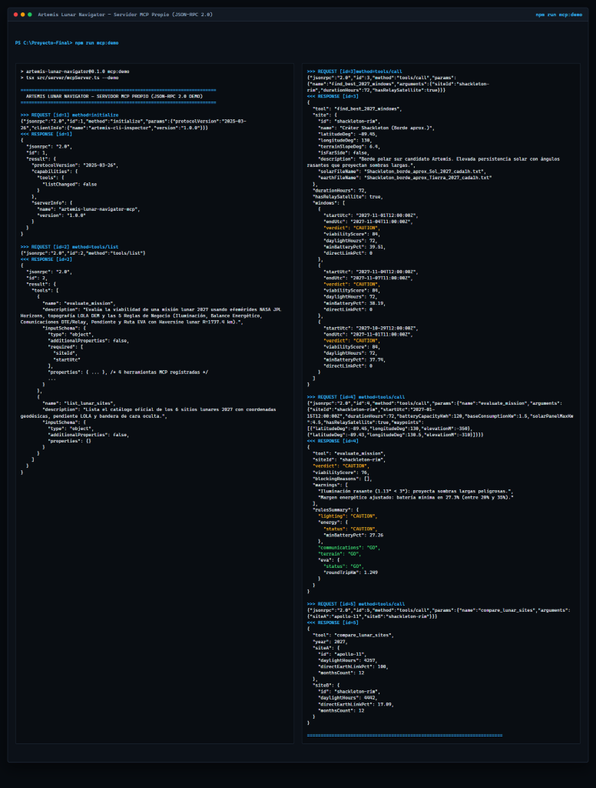
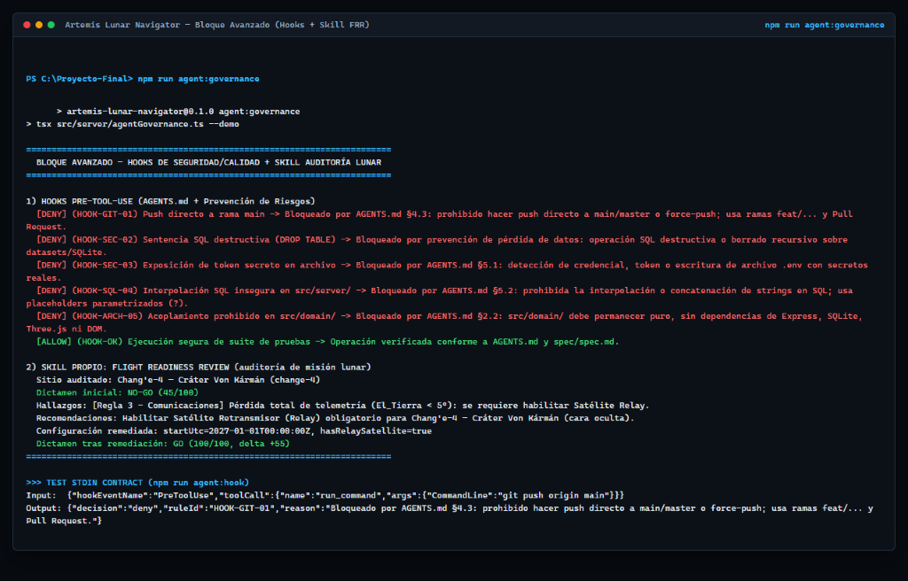

# Integración MCP y Bloque Avanzado (`docs/mcp.md`)

Documentación técnica de la **Semana 10 (Model Context Protocol)** y de los componentes del **Bloque Avanzado (Sección A.3 de la rúbrica)** implementados en **Artemis Lunar Navigator**.

---

## 1. Uso de MCP y Herramientas Agentic Durante el Desarrollo

Durante la construcción del proyecto en **Antigravity IDE**, el desarrollo asistido por agentes se estructuró sobre tres pilares:

1. **Reglas Persistentes (`AGENTS.md`) y Context Engineering (`docs/contexto_referencia.md`):**
   * Mantienen el contexto compacto para evitar saturación de ventana y alucinaciones, restringiendo el árbol oficial de carpetas y la separación estricta en capas MVVM (`models` -> `domain` -> `services` -> `viewmodels` -> `views` / `server`).
2. **Skills y Guías Especializadas (`modern-web-guidance` y `chrome-devtools`):**
   * En el Paso 4 se aplicó la guía `modern-web-guidance` para construir la consola HUD OpenMCT con elementos semánticos nativos (`<dialog closedby="any">`, `<main>`, `<dl>`), variables CSS modernas (`color-mix(in oklab, ...)`), prevención XSS sin `innerHTML` y accesibilidad ARIA.
   * En el Paso 5 se validó la aplicación compilada en vivo en el navegador y se automatizó la captura de evidencias visuales sobre la consola 3D y los flujos CRUD.
3. **Servidor MCP Propio (`artemis-lunar-navigator-mcp`):**
   * Expone el motor determinista de viabilidad lunar (`MissionEvaluator`) y los datasets reales de **NASA JPL Horizons 2027** y **LOLA DEM** directamente como herramientas MCP para cualquier cliente o agente de IA compatible.

---

## 2. Arquitectura del Servidor MCP Propio (`src/server/mcpServer.ts`)

El módulo [`src/server/mcpServer.ts`](../src/server/mcpServer.ts) implementa la clase `LunarNavigatorMcpServer` sobre el estándar **JSON-RPC 2.0** (compatible con la especificación MCP `2025-03-26`), reutilizando sin duplicación:
* `TelemetryCatalogService` (lectura y caché de los 12 archivos `.txt` de JPL Horizons 2027).
* `validateMissionConfigInput` (validación estricta de rangos físicos según `RNF-01`).
* `evaluateMissionAtStart` y `findBestLandingWindows` (motor puro de las 5 Reglas de Negocio).

### 2.1 Transporte Dual (Stdio Local + HTTP JSON-RPC)
1. **Transporte Stdio (`npm run mcp:server`):**
   * Escucha peticiones JSON-RPC 2.0 línea por línea en `stdin` y responde en `stdout`. Ideal para integrarlo en `mcp_config.json` de IDEs o clientes MCP locales.
2. **Transporte HTTP (`POST /api/mcp` en `src/server/app.ts`):**
   * Expone el mismo protocolo JSON-RPC 2.0 sobre Express (`200 OK` para solicitudes con `id`, `204 No Content` para notificaciones como `notifications/initialized`).
3. **Modo Demo CLI (`npm run mcp:demo`):**
   * Ejecuta un ciclo completo (`initialize` -> `tools/list` -> `find_best_2027_windows` -> `evaluate_mission` -> `compare_lunar_sites`) contra los datasets reales de 2027.

### 2.2 Métodos JSON-RPC Soportados
* `initialize` — Negocia la versión de protocolo (`2025-03-26`) y declara capacidad `tools`.
* `notifications/initialized` — Confirmación de handshake sin cuerpo de respuesta cuando llega como notificación.
* `ping` — Verificación de disponibilidad del servidor (`{}`).
* `tools/list` — Devuelve los esquemas JSON Schema de las 4 herramientas expuestas.
* `tools/call` — Ejecuta la herramienta solicitada; errores de dominio o validación (`ValidationError`, `NotFoundError`, `RangeError`) devuelven un resultado MCP controlado con `isError: true`, mientras que métodos o herramientas inexistentes retornan códigos JSON-RPC estándar (`-32601`, `-32602`, `-32600`).

### 2.3 Ejemplo de Configuración en `mcp_config.json`

```json
{
  "mcpServers": {
    "artemis-lunar-navigator": {
      "command": "npx",
      "args": ["tsx", "src/server/mcpServer.ts"],
      "env": {
        "NODE_ENV": "production"
      }
    }
  }
}
```

---

## 3. Especificación de Herramientas MCP Expuestas

| Herramienta | Propósito | Parámetros obligatorios | Fuente de datos |
| :--- | :--- | :--- | :--- |
| **`evaluate_mission`** | Evalúa las 5 Reglas de Negocio (`GO`/`CAUTION`/`NO-GO`, score 0–100 y curva SoC horaria). | `siteId`, `startUtc` | `MissionEvaluator` + JPL Horizons 2027 |
| **`find_best_2027_windows`** | Recorre las 8,760 h de 2027 con ventana deslizante y retorna las 3 mejores fechas no solapadas. | `siteId` | `findBestLandingWindows` + JPL Horizons |
| **`compare_lunar_sites`** | Compara dos sitios durante todo 2027 (horas de sol, sombras rasantes y enlace DTE $\ge 5^\circ$ por mes). | `siteA`, `siteB` | `TelemetryCatalogService.compareSites` |
| **`list_lunar_sites`** | Lista los 6 sitios oficiales con coordenadas, pendiente LOLA y bandera de cara oculta. | *(ninguno)* | `LUNAR_SITES` |

### Ejemplo Real: `evaluate_mission` sobre `shackleton-rim`

**Petición JSON-RPC 2.0:**
```json
{
  "jsonrpc": "2.0",
  "id": 4,
  "method": "tools/call",
  "params": {
    "name": "evaluate_mission",
    "arguments": {
      "siteId": "shackleton-rim",
      "startUtc": "2027-01-15T12:00:00Z",
      "durationHours": 72,
      "batteryCapacityKwh": 120,
      "baseConsumptionKw": 1.5,
      "solarPanelMaxKw": 4.5,
      "hasRelaySatellite": true,
      "waypoints": [
        { "latitudeDeg": -89.45, "longitudeDeg": 130.0, "elevationM": -350 },
        { "latitudeDeg": -89.43, "longitudeDeg": 130.5, "elevationM": -310 }
      ]
    }
  }
}
```

**Resumen de Respuesta Observada (`npm run mcp:demo`):**
```json
{
  "verdict": "CAUTION",
  "viabilityScore": 76,
  "warnings": [
    "Iluminación rasante (1.13° < 3°): proyecta sombras largas peligrosas.",
    "Margen energético ajustado: batería mínima en 27.3% (entre 20% y 35%)."
  ],
  "rulesSummary": {
    "lighting": "CAUTION",
    "energy": { "status": "CAUTION", "minBatteryPct": 27.26 },
    "communications": "GO",
    "terrain": "GO",
    "eva": { "status": "GO", "roundTripKm": 1.249 }
  }
}
```

### Ejemplo Real: `compare_lunar_sites` (`apollo-11` vs. `shackleton-rim`)

```json
{
  "year": 2027,
  "siteA": {
    "id": "apollo-11",
    "daylightHours": 4257,
    "directEarthLinkPct": 100,
    "monthsCount": 12
  },
  "siteB": {
    "id": "shackleton-rim",
    "daylightHours": 4442,
    "directEarthLinkPct": 17.09,
    "monthsCount": 12
  }
}
```

---

## 4. Bloque Avanzado (`src/server/agentGovernance.ts` — Sección A.3)

Para el Bloque Avanzado se implementaron de forma integrada dos mecanismos ejecutables y verificados en pruebas automatizadas ([`test/agentGovernance.test.ts`](../test/agentGovernance.test.ts)):

### 4.1 Hooks de Calidad y Seguridad Agentic (`evaluatePreToolUseHook`)
Implementa el contrato `PreToolUse` (`stdin` JSON -> `stdout` JSON `{ decision, ruleId, reason }`) ejecutable mediante `npm run agent:hook` para bloquear violaciones de `AGENTS.md`:
* **`HOOK-GIT-01`:** Bloquea `git push` directo a `main`/`master` o `git push --force` / `-f`.
* **`HOOK-SEC-02`:** Bloquea SQL destructivo (`DROP TABLE`, `TRUNCATE`, `DELETE` sin `WHERE`) y borrados recursivos (`rm -rf`, `Remove-Item -Recurse`) sobre `data/` o archivos `.sqlite`.
* **`HOOK-SEC-03`:** Detecta e impide escribir credenciales reales (`ghp_...`, `sk-...`, `AIza...`) o archivos `.env` con secretos.
* **`HOOK-SQL-04`:** Impide editar archivos en `src/server/` introduciendo interpolación o concatenación de strings en sentencias SQL (exige *prepared statements* `?`).
* **`HOOK-ARCH-05`:** Protege el aislamiento puro de `src/domain/`, bloqueando importaciones de `three`, `express`, `better-sqlite3` o referencias a `window.` / `document.`.

### 4.2 Skill Propio de Auditoría Lunar (`runLunarMissionAuditSkill`)
Automatiza una revisión **Flight Readiness Review (FRR)** sobre una configuración de misión:
1. Evalúa el plan inicial con las 5 Reglas de Negocio.
2. Ejecuta el barrido anual 2027 (`findBestLandingWindows`) y compara contra el sitio de referencia (`shackleton-rim` o `apollo-11`).
3. Simula remediaciones concretas (activar Satélite Relay en cara oculta / mover alunizaje a la ventana #1 de 2027) y cuantifica la mejora (`scoreDelta`).
4. Ejemplo verificado en `npm run agent:governance`: auditar *Chang'e-4* sin Relay pasa de **`NO-GO (45/100)`** a **`GO (100/100, delta +55)`**.

---

## 5. Evidencias de Funcionamiento

* **Servidor MCP ejecutándose con herramientas reales:**
  

* **Hooks de Seguridad/Calidad y Skill de Auditoría FRR (Bloque Avanzado):**
  
