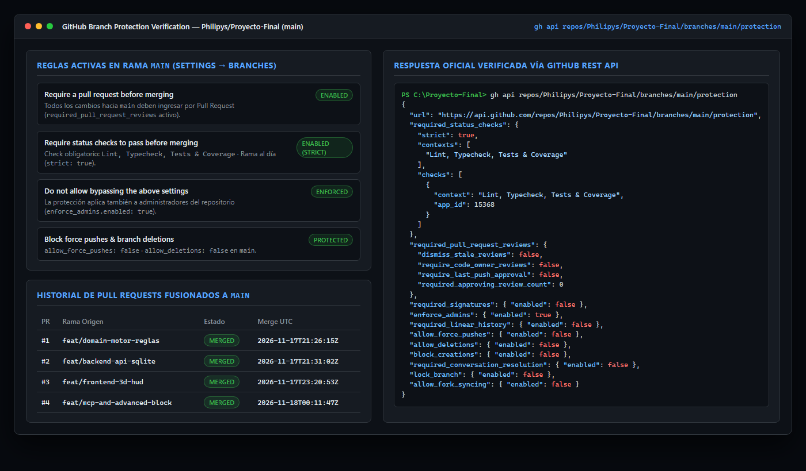
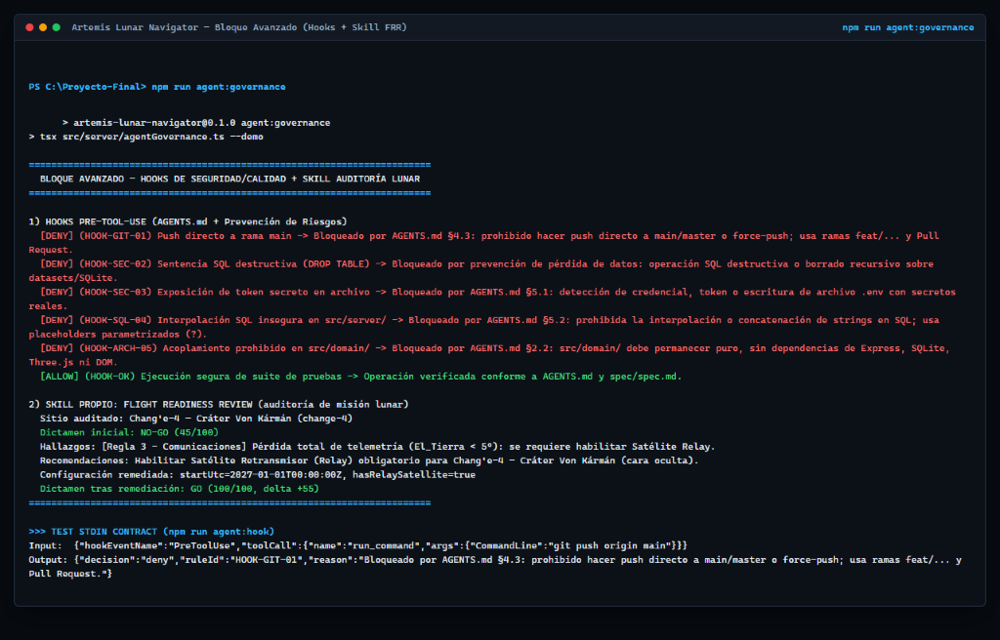

# Seguridad del Sistema (`docs/seguridad.md`)

Este documento formaliza la postura de seguridad de **Artemis Lunar Navigator** conforme a las Semanas 13–14 del curso y la Sección 5 de [`AGENTS.md`](../AGENTS.md): modelo de amenazas, validación y sanitización de entradas, consultas SQL parametrizadas, gestión de secretos, controles *agentic* con Hooks `PreToolUse`, protección de la rama `main` y auditoría de dependencias.

---

## 1. Superficie de Ataque y Modelo de Amenazas (STRIDE)

### 1.1 Activos Críticos
1. **Motor determinista de viabilidad (`src/domain/MissionEvaluator.ts`):** Dictámenes `GO` / `CAUTION` / `NO-GO` y puntaje de viabilidad (`0–100`).
2. **Base de datos SQLite (`data/lunar_missions.sqlite`):** Planes de misión persistidos (`missions`) y rutas EVA asociadas (`eva_waypoints`).
3. **Datasets científicos NASA (`data/horizons/` y `data/lola/`):** 12 archivos de efemérides JPL Horizons 2027, etiqueta PDS `.lbl` y subventana LOLA DEM.
4. **Backend REST y Servidor MCP (`src/server/app.ts`, `src/server/mcpServer.ts`):** Superficie HTTP (`POST/PUT/DELETE /api/missions`, `POST /api/mcp`) y transporte local `stdio`.
5. **Integridad del repositorio (`main` en GitHub):** Código fuente, suite de pruebas y pipeline CI/CD.

### 1.2 Matriz de Amenazas y Controles Implementados

| Categoría STRIDE | Amenaza Identificada | Control Técnico Implementado | Archivo / Evidencia |
| :--- | :--- | :--- | :--- |
| **Spoofing / Tampering** | Cliente HTTP envía un `verdict: "GO"` o `viabilityScore: 100` manipulado para guardar una misión insegura en SQLite. | **Recálculo autoritativo en servidor:** `POST /api/missions` y `PUT /api/missions/:id` ignoran cualquier dictamen enviado por el cliente y ejecutan `evaluateMissionAtStart()` en el servidor antes de persistir. | [`src/server/app.ts`](../src/server/app.ts) |
| **Tampering (SQLi)** | Inyección SQL en identificadores, nombres de misión o notas técnicas. | **Consultas 100% parametrizadas (`?`):** Toda lectura y escritura en `better-sqlite3` utiliza *prepared statements* con placeholders `?`, `PRAGMA foreign_keys = ON`, restricciones `CHECK` en esquema y transacciones `.immediate()`. Prohibida la concatenación de strings SQL. | [`src/server/SqliteMissionRepository.ts`](../src/server/SqliteMissionRepository.ts) |
| **Tampering / XSS** | Inyección de `<script>` o etiquetas HTML en `name` o `notes` (XSS almacenado o reflejado). | **Defensa en profundidad:** (1) `sanitizeText()` elimina caracteres de control, bloques `<script>`, etiquetas HTML y escapa `<` y `>`; (2) la vista HUD construye todo el DOM mediante `document.createElement` y `textContent`, con **cero** usos de `innerHTML` en `src/`. | [`src/server/validators.ts`](../src/server/validators.ts), [`src/views/HudConsoleView.ts`](../src/views/HudConsoleView.ts) |
| **Information Disclosure** | Exposición de rutas del sistema, trazas internas de SQLite o cabeceras de servidor; filtración de secretos en Git. | `app.disable('x-powered-by')`; manejador global de errores retorna mensajes controlados (`400`, `404`, `500`) sin stack traces; CORS restringido a `CORS_ORIGIN`; historial Git auditado sin `.env` ni `.sqlite`. | [`src/server/app.ts`](../src/server/app.ts), [`.gitignore`](../.gitignore) |
| **Denial of Service (DoS)** | Payloads JSON masivos, arreglos infinitos de waypoints, duraciones negativas o coordenadas lunares absurdas. | Límite de cuerpo `express.json({ limit: '256kb' })`; validación estricta de tipos y rangos finitos en `validateMissionConfigInput` y `validateWaypoints`. | [`src/server/validators.ts`](../src/server/validators.ts) |
| **Elevation of Privilege** | Modificación directa de `main`, ejecución de SQL destructivo o alteración del flujo CI/CD por un agente de IA. | Rama `main` protegida en GitHub (`enforce_admins: true`, PR + CI verde obligatorio); pipeline CI con permisos mínimos `contents: read`; Hooks `PreToolUse` (`HOOK-GIT-01` a `HOOK-ARCH-05`). | [`.github/workflows/ci.yml`](../.github/workflows/ci.yml), [`src/server/agentGovernance.ts`](../src/server/agentGovernance.ts) |

---

## 2. Validación Estricta de Entradas y Sanitización (`src/server/validators.ts`)

Todas las rutas mutadoras (`POST /api/missions/evaluate`, `POST /api/missions`, `PUT /api/missions/:id`) y herramientas del servidor MCP (`evaluate_mission`, `find_best_2027_windows`, `compare_lunar_sites`) validan explícitamente las entradas antes de tocar el dominio o la base de datos:

* **Coordenadas lunares (`validateLunarCoordinates`):** `latitudeDeg ∈ [-90, 90]`, `longitudeDeg ∈ [-180, 180]`, valores finitos (`Number.isFinite`).
* **Elevación de waypoint:** finita y acotada a `[-15000, 15000]` metros; máximo `MAX_WAYPOINTS = 50` por misión.
* **Parámetros físicos de misión:**
  * `siteId`: debe existir en el catálogo oficial de 6 sitios (`LUNAR_SITES`).
  * `startUtc`: cadena ISO-8601 UTC normalizada con `Date.parse`.
  * `durationHours`: entero estrictamente en `[1, 720]` horas.
  * `batteryCapacityKwh`: finito en `(0, 10000]`.
  * `baseConsumptionKw`: finito en `(0, 1000]`.
  * `solarPanelMaxKw`: finito en `[0, 1000]`.
  * `terrainSlopeDeg` (opcional): finito en `[0, 90]` grados.
  * `evaSpeedKmh` (opcional): finito en `(0, 100]`; `maxEvaRangeKm` (opcional): finito en `(0, 1000]`.
* **Cadenas de texto (`sanitizeText`):** `name` obligatorio (`1–120` caracteres tras sanitización) y `notes` (`0–2000` caracteres), limpiando caracteres de control y etiquetas HTML/script.
* **Identificadores de ruta (`getParamId`):** máximo 128 caracteres; JSON malformado retorna `400 Bad Request` controlado.

---

## 3. Gestión de Secretos y Principio de Mínimo Privilegio

1. **Cero credenciales necesarias para fuentes NASA:** Los datasets oficiales de **NASA JPL Horizons API** y **LRO LOLA PDS** son servicios públicos científicos sin autenticación por API key, y las efemérides de 2027 operan localmente en `data/`.
2. **Plantilla sin secretos (`.env.example`):** Solo define configuración operativa no sensible (`PORT=3000`, `NODE_ENV=development`, `DB_PATH=./data/lunar_missions.sqlite`, `CORS_ORIGIN=http://localhost:5173`, `NASA_HORIZONS_API_URL`).
3. **Verificación del historial Git:** El archivo `.gitignore` excluye `.env`, `.env.*` (con excepción explícita `!.env.example`), `*.sqlite*` y `_archivos_originales_profe/`. La inspección de `git ls-files` y `git log --all --stat -- "*.env*" "*.sqlite*"` confirma que solo `.env.example` forma parte del historial del repositorio.
4. **Mínimo privilegio en CI/CD:** [`.github/workflows/ci.yml`](../.github/workflows/ci.yml) declara explícitamente `permissions: contents: read`.
5. **Protección de rama `main` en GitHub:** Verificada vía `gh api repos/Philipys/Proyecto-Final/branches/main/protection`:
   * `required_pull_request_reviews`: exige Pull Request antes de fusionar a `main`.
   * `required_status_checks`: `strict: true` con check obligatorio **`Lint, Typecheck, Tests & Coverage`**.
   * `enforce_admins.enabled`: `true` (nadie, incluidos administradores, puede omitir los checks).
   * `allow_force_pushes: false` y `allow_deletions: false`.

---

## 4. Controles de Seguridad *Agentic* (`PreToolUse` Hooks)

Para prevenir errores destructivos o regresiones de seguridad generadas por agentes de IA durante el desarrollo, [`src/server/agentGovernance.ts`](../src/server/agentGovernance.ts) implementa `evaluatePreToolUseHook` (ejecutable mediante `npm run agent:hook` sobre `stdin`/`stdout` JSON) con 5 reglas deterministas verificadas en [`test/agentGovernance.test.ts`](../test/agentGovernance.test.ts):

| Regla | Qué Bloquea (`decision: "deny"`) | Referencia |
| :--- | :--- | :--- |
| **`HOOK-GIT-01`** | `git push` directo a `main`/`master` o uso de `--force` / `-f`. | `AGENTS.md §4.3` |
| **`HOOK-SEC-02`** | SQL destructivo (`DROP TABLE`, `TRUNCATE`, `DELETE` sin `WHERE`) y borrados recursivos (`rm -rf`, `Remove-Item -Recurse`) sobre `data/` o archivos `.sqlite`. | Prevención de pérdida de datos |
| **`HOOK-SEC-03`** | Escritura de tokens/secretos (`ghp_...`, `github_pat_...`, `sk-...`, `AIza...`) o creación de archivos `.env` con credenciales reales. | `AGENTS.md §5.1` |
| **`HOOK-SQL-04`** | Interpolación (`${...}`) o concatenación `+` de strings dentro de consultas SQL en `src/server/`. | `AGENTS.md §5.2` |
| **`HOOK-ARCH-05`** | Importaciones impuras (`express`, `better-sqlite3`, `three`, `cors`) o acceso al DOM (`window.`, `document.`) dentro de `src/domain/`. | `AGENTS.md §2.2` |

---

## 5. Auditoría de Dependencias (`npm audit`)

En cumplimiento de `AGENTS.md §5.4`, se mantuvieron dependencias mínimas y verificadas:

* **Dependencias de producción (`4` paquetes directos):** `better-sqlite3` (`^13.2.0`), `cors` (`^2.8.6`), `express` (`^5.3.0`) y `three` (`^0.187.0`).
* **Resultado de `npm audit --omit=dev`:** **`found 0 vulnerabilities`** (0 críticas, 0 altas, 0 moderadas, 0 bajas en producción).
* **Resultado de `npm audit` completo (incluyendo `devDependencies`):** Reporta `12 high severity vulnerabilities` originadas todas en una única dependencia transitiva de desarrollo: `picomatch` (`GHSA-fc5q-39xc-vjpf`, ReDoS en `extglobs`) utilizada por `fdir` / `tinyglobby` dentro de las herramientas de compilación y prueba (`vite`, `vitest`, `@vitest/coverage-v8`, `typescript-eslint`). No se empaqueta ni se ejecuta en el servidor Express ni en el bundle del navegador, y su remediación automática (`npm audit fix --force`) degradaría `vitest` a una versión incompatible (`3.1.4`). Se documenta como riesgo aceptado exclusivo del entorno local de desarrollo/CI.
